# 🏛️ Tài Liệu Thiết Kế Kiến Trúc Hệ Thống (Architecture Design Document)
## Dự án: Ngân Hàng Số RikkeiBank API

---

## 1. Phân Tích & Chuyển Đổi Kiến Trúc: Monolithic vs Microservices (MSA)

### 1.1 Hạn chế của hệ thống Monolithic trước đây của RikkeiBank:
1. **Single Point of Failure (SPOF):** Một lỗi tràn bộ nhớ hoặc rò rỉ kết nối tại module tính lãi tiết kiệm có thể làm sập toàn bộ hệ thống đăng nhập và chuyển khoản của khách hàng.
2. **Khó mở rộng theo tải (Scaling Inflexibility):** Vào ngày trả lương (cuối tháng), lưu lượng giao dịch chuyển khoản tăng gấp 20 lần, trong khi nghiệp vụ quản lý hồ sơ nhân viên hay danh mục loại tài khoản hầu như không đổi. Monolithic buộc phải nhân bản toàn bộ ứng dụng cồng kềnh.
3. **Phụ thuộc công nghệ và chậm phát hành:** Mọi thay đổi dù nhỏ đều yêu cầu kiểm thử hồi quy và build/deploy lại toàn bộ khối ứng dụng khổng lồ.

### 1.2 Lý do lựa chọn Microservices Architecture (MSA) cho RikkeiBank:
- **Tách rời nghiệp vụ độc lập (Loose Coupling & High Cohesion):** Mỗi nghiệp vụ ngân hàng được đóng gói trong một microservice riêng biệt (`identity-service`, `customer-service`, `account-service`, `transaction-service`, `notification-service`).
- **Mở rộng độc lập (Independent Scalability):** `transaction-service` và `account-service` có thể scale lên 10 instances trong giờ cao điểm mà không lãng phí tài nguyên cho các service ít tải.
- **Kháng lỗi và cách ly sự cố (Fault Isolation & Resilience):** Nhờ cơ chế Circuit Breaker (Resilience4j), sự cố tại một dịch vụ không làm tê liệt toàn bộ luồng nghiệp vụ.
- **Database-per-Service:** Đảm bảo tính toàn vẹn và bảo mật dữ liệu tuyệt đối giữa các phân hệ ngân hàng.

---

## 2. Thiết Kế Cơ Sở Dữ Liệu Phân Tán (Database-per-Service)

Mỗi Microservice sở hữu schema / database riêng biệt và tuyệt đối không truy cập trực tiếp vào bảng dữ liệu của microservice khác:

```mermaid
classDiagram
    class DB_Identity {
        <<Database: rikkeibank_identity>>
        +users (id, email, password, role, status)
    }

    class DB_Customer {
        <<Database: rikkeibank_customer>>
        +customers (id, customer_code, user_id, identity_number, phone, email)
        +staff (id, staff_code, user_id, branch_code, department, role)
        +account_types (id, type_code, type_name, interest_rate, min_balance)
    }

    class DB_Account {
        <<Database: rikkeibank_account>>
        +bank_accounts (id, account_number, customer_id, type_code, balance, status)
    }

    class DB_Transaction {
        <<Database: rikkeibank_transaction>>
        +transactions (id, ref_code, from_acc, to_acc, amount, type, status, failure_reason)
    }

    class DB_Notification {
        <<Database: rikkeibank_notification>>
        +notifications (id, customer_id, title, message, event_type, status)
    }
```

---

## 3. Cơ Chế Giao Tiếp Giữa Các Microservices

### 3.1 Giao tiếp Đồng bộ (Synchronous Communication)
- **Công nghệ:** `Spring Cloud OpenFeign` kết hợp `Spring Cloud LoadBalancer` và `Eureka Discovery Client`.
- **Áp dụng:** 
  - `transaction-service` gọi `account-service` để trừ tiền (Debit) và cộng tiền (Credit).
  - Tự động phân giải địa chỉ qua Service Name: `http://account-service`.
  - Được bọc bởi `@CircuitBreaker` để chống nghẽn đường truyền khi service đích phản hồi chậm.

### 3.2 Giao tiếp Bất đồng bộ (Asynchronous Event-Driven Communication)
- **Công nghệ:** `Apache Kafka` + `Spring WebFlux`.
- **Áp dụng:**
  - `transaction-service` phát hành sự kiện (Publisher) lên Kafka topic `transaction-events` (`SAGA_TRANSFER_STARTED`, `SAGA_DEBITED`, `SAGA_TRANSFER_COMPLETED`, `SAGA_TRANSFER_COMPENSATED`).
  - `notification-service` (Kafka Consumer) tiêu thụ sự kiện bất đồng bộ để lưu vết thông báo và đẩy qua Server-Sent Events (SSE) tới ứng dụng khách hàng mà không làm chậm luồng chuyển khoản chính.

---

## 4. Chiến Lược Caching Phân Tán (Distributed Cache-Aside)

Sử dụng **Redis Server** làm bộ nhớ đệm phân tán với mô hình **Cache-Aside Pattern**:
1. **Đọc dữ liệu:** Ứng dụng kiểm tra Redis trước (`@Cacheable`). Nếu có dữ liệu (*Cache HIT*), trả về ngay lập tức. Nếu chưa có (*Cache MISS*), ứng dụng truy vấn Database, lưu kết quả vào Redis với TTL và trả về cho Client.
2. **Ghi/Cập nhật dữ liệu:** Khi có thay đổi (sửa thông tin khách hàng, thay đổi số dư, cập nhật lãi suất), hệ thống cập nhật Database đồng thời xóa hoặc làm mới cache tương ứng (`@CacheEvict` / `@CachePut`).
3. **Bảo mật:** Sử dụng Redis làm kho lưu trữ Token Blacklist (`blacklist:token:*`, `blacklist:user:*`) phục vụ chức năng Đăng xuất và Ép buộc đăng xuất tức thời của Quản trị viên.
