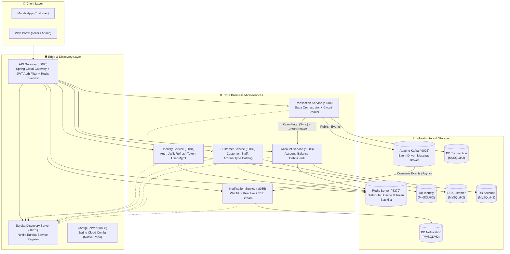
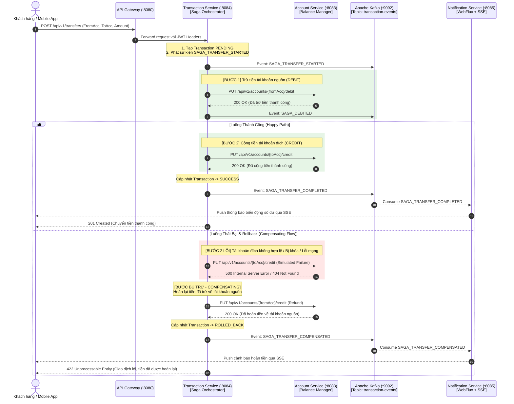

# 🏦 Ngân Hàng Số RikkeiBank API (Microservices Architecture)

> **Dự án:** Ngân hàng số "RikkeiBank API"  
> **Lĩnh vực:** Tài chính – Ngân hàng (Fintech)  
> **Khách hàng:** Chi nhánh ngân hàng bán lẻ RikkeiBank  
> **Công nghệ:** Java 17+, Spring Boot 3.3.5, Spring Cloud 2023.0.3, Spring Cloud Gateway, Netflix Eureka, Spring Cloud Config, Resilience4j Circuit Breaker, Apache Kafka, Spring WebFlux (Reactive), Redis Cache-Aside & Token Blacklist, MySQL 8.0 & H2 In-Memory.

---

## 📑 Bảng Mục Lục
1. [Tổng Quan Kiến Trúc & Sơ Đồ Hệ Thống](#1-tổng-quan-kiến-trúc--sơ-đồ-hệ-thống)
2. [Danh Sách Microservices & Cổng Dịch Vụ](#2-danh-sách-microservices--cổng-dịch-vụ)
3. [Các Tính Năng Cốt Lõi & Nghiệp Vụ](#3-các-tính-năng-cốt-lõi--nghiệp-vụ)
4. [Mô Hình Saga Pattern & Kịch Bản Rollback](#4-mô-hình-saga-pattern--kịch-bản-rollback)
5. [Cơ Chế Bảo Mật & Đăng Xuất Ép Buộc (Redis Blacklist)](#5-cơ-chế-bảo-mật--đăng-xuất-ép-buộc-redis-blacklist)
6. [Kháng Lỗi & Caching (Resilience4j & Redis)](#6-kháng-lỗi--caching-resilience4j--redis)
7. [Hướng Dẫn Khởi Chạy Hệ Thống](#7-hướng-dẫn-khởi-chạy-hệ-thống)
8. [Bộ Sưu Tập Postman API & Kịch Bản Kiểm Thử](#8-bộ-sưu-tập-postman-api--kịch-bản-kiểm-thử)

---

## 1. Tổng Quan Kiến Trúc & Sơ Đồ Hệ Thống

Hệ thống được chuyển đổi hoàn toàn từ kiến trúc Monolithic tập trung sang kiến trúc **Microservices phân tán (MSA)** tuân thủ nguyên tắc **Database-per-service** độc lập, đảm bảo bảo mật tài chính, mở rộng độc lập và chống lỗi dây chuyền (*Cascading Failures*).



---

## 2. Danh Sách Microservices & Cổng Dịch Vụ

| Service Name | Port | Chức năng chính | Cơ sở dữ liệu | Caching / Messaging |
|---|---|---|---|---|
| **`config-server`** | `8888` | Quản lý cấu hình tập trung từ `config-repo/` | - | - |
| **`eureka-server`** | `8761` | Service Registry & Discovery khám phá dịch vụ | - | - |
| **`api-gateway`** | `8080` | Định tuyến request, Load Balancing, JWT Filter, kiểm tra Redis Blacklist | - | Redis (Reactive) |
| **`identity-service`** | `8081` | Đăng ký, Đăng nhập, JWT, Refresh Token (30 ngày), Ép buộc đăng xuất | `rikkeibank_identity` | Redis Blacklist |
| **`customer-service`** | `8082` | Quản lý Hồ sơ Khách hàng, Nhân viên, Danh mục Loại tài khoản | `rikkeibank_customer` | Redis Cache-Aside |
| **`account-service`** | `8083` | Quản lý Tài khoản Ngân hàng, Số dư, Trừ/Cộng tiền trực tiếp | `rikkeibank_account` | Redis Cache-Aside |
| **`transaction-service`**| `8084` | Điều phối Saga chuyển tiền, Circuit Breaker, Báo cáo giao dịch GDV | `rikkeibank_transaction` | Kafka Producer |
| **`notification-service`**| `8085` | WebFlux Reactive, Nhận sự kiện Kafka, Push thông báo qua SSE | `rikkeibank_notification` | Kafka Consumer + SSE |

---

## 3. Các Tính Năng Cốt Lõi & Nghiệp Vụ

### 👥 Quản trị Phân quyền (RBAC) & Trải nghiệm Đăng nhập:
- **`ROLE_ADMIN` (Quản trị viên):** Toàn quyền CRUD Khách hàng, Nhân viên, Loại tài khoản; Có quyền **Ép buộc đăng xuất** bất kỳ tài khoản nào lập tức qua Redis Blacklist.
- **`ROLE_TELLER` (Giao dịch viên):** Mở tài khoản cho khách, thực hiện nộp/rút tiền, xem danh sách giao dịch trong ca/phạm vi được phân công; Không can thiệp vào giao dịch của giao dịch viên khác.
- **`ROLE_CUSTOMER` (Khách hàng):** Xem tài khoản của chính mình, xem lịch sử biến động số dư, thực hiện chuyển khoản trực tuyến 24/7; Duy trì đăng nhập lâu dài qua Refresh Token (30 ngày).
- **Khách vãng lai:** Không thể xem bất kỳ thông tin tài chính nào (HTTP 401/403).

### 💳 Quản lý Danh mục & Hồ sơ (Catalog Management):
- Danh mục Loại tài khoản: `CHECKING` (Thanh toán), `SAVINGS_REGULAR` (Tiết kiệm), `VIP_GOLD` (Khách hàng VIP).
- Quản lý hồ sơ khách hàng đầy đủ: Mã KH (`CUSTxxx`), CCCD/CMND, Ngày sinh, Địa chỉ, Số điện thoại, Email.

---

## 4. Mô Hình Saga Pattern & Kịch Bản Rollback

Giao dịch chuyển tiền giữa 2 tài khoản áp dụng mô hình **Saga Pattern (Orchestrator)** kết hợp cơ chế **Compensating Rollback** khi có lỗi ở bất kỳ bước nào:



---

## 5. Cơ Chế Bảo Mật & Đăng Xuất Ép Buộc (Redis Blacklist)

- **Authentication Filter:** API Gateway tự động xác thực chữ ký JWT, kiểm tra `blacklist:token:<token>` và `blacklist:user:<userId>` trong Redis Reactive.
- **ADMIN Force-Logout:** Khi Admin gọi `POST /api/v1/auth/force-logout/{userId}`, hệ thống ghi khóa `blacklist:user:{userId}` vào Redis với TTL 30 ngày. Mọi request tiếp theo sử dụng token của User này ngay lập tức bị API Gateway chặn lại với HTTP 401 Unauthorized.

---

## 6. Kháng Lỗi & Caching (Resilience4j & Redis)

- **Resilience4j Circuit Breaker:**
  - Cấu hình instance `accountServiceCB` bảo vệ các cuộc gọi FeignClient từ `transaction-service` sang `account-service`.
  - 3 trạng thái: `CLOSED` (bình thường) -> `OPEN` (ngắt mạch khi tỷ lệ lỗi vượt ngưỡng 50%) -> `HALF_OPEN` (thử nghiệm phục hồi).
  - Có phương thức Fallback method trả về thông báo an toàn, chống đổ vỡ hệ thống theo dây chuyền.
- **Distributed Caching (Redis Cache-Aside):**
  - `@Cacheable(value = "customers", key = "#id")`
  - `@Cacheable(value = "accounts-by-number", key = "#accountNumber")`
  - `@Cacheable(value = "account-types-all")`
  - `@CacheEvict` tự động xóa cache khi có cập nhật số dư, thông tin khách hàng, hoặc danh mục loại tài khoản.

---

## 7. Hướng Dẫn Khởi Chạy Hệ Thống

### Cách 1: Khởi chạy bằng Docker Compose (Khuyên dùng)
```bash
# Di chuyển vào thư mục dự án
cd ss18/mini-project

# Khởi động toàn bộ hạ tầng: MySQL, Redis, Zookeeper, Kafka, Kafka-UI
docker compose up -d
```

### Cách 2: Chạy các Microservices bằng Gradle hoặc Maven
```bash
# 1. Khởi động Config Server
gradle :config-server:bootRun

# 2. Khởi động Eureka Server (chờ 5 giây)
gradle :eureka-server:bootRun

# 3. Khởi động API Gateway
gradle :api-gateway:bootRun

# 4. Khởi động các Core Services
gradle :identity-service:bootRun
gradle :customer-service:bootRun
gradle :account-service:bootRun
gradle :transaction-service:bootRun
gradle :notification-service:bootRun
```

> **Ghi chú:** Mỗi service đều có cấu hình database H2 In-Memory tự động dự phòng, giúp hệ thống có thể chạy kiểm thử tức thì ngay cả khi chưa khởi động MySQL!

---

## 8. Bộ Sưu Tập Postman API & Kịch Bản Kiểm Thử

File Postman Collection và Environment đã được tạo sẵn tại:
- `postman/RikkeiBank_API.postman_collection.json`
- `postman/RikkeiBank_Environment.postman_environment.json`

### Dữ Liệu Khởi Tạo Sẵn Trong Hệ Thống (Seed Data):

| Đối tượng | Email / Mã | Mật khẩu / Số tài khoản | Vai trò / Số dư |
|---|---|---|---|
| **Admin** | `admin@rikkeibank.com` | `admin123` | `ROLE_ADMIN` |
| **Teller (GDV)** | `teller01@rikkeibank.com` | `teller123` | `ROLE_TELLER` |
| **Customer 1** | `customer01@gmail.com` | `customer123` | STK: `1000123456` (100.000.000 VND) |
| **Customer 2** | `customer02@gmail.com` | `customer123` | STK: `1000654321` (50.000.000 VND) |
| **Customer 1 (Tiết kiệm)** | `customer01@gmail.com` | - | STK: `1000999888` (200.000.000 VND) |

---
**RikkeiBank Digital Banking Microservices - Developed with Excellence**
