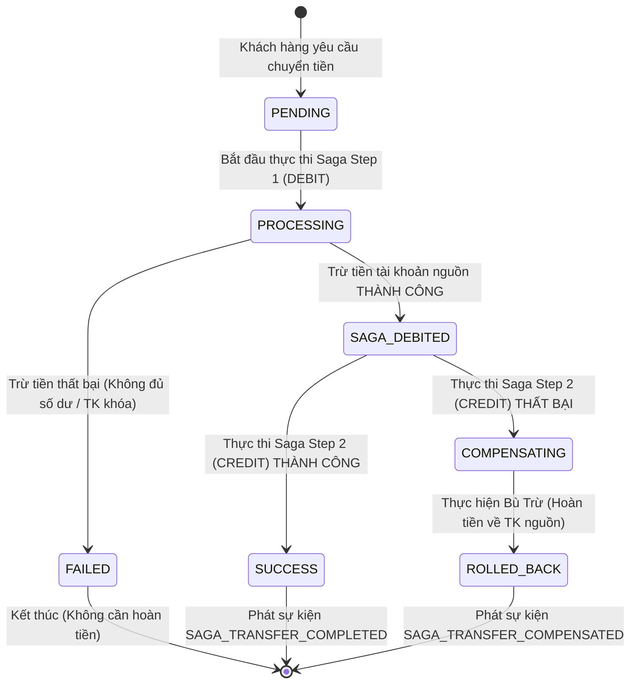

# 🔄 Tài Liệu Luồng Giao Dịch Phân Tán (Saga Pattern & Compensating Flow)
## Dự án: Ngân Hàng Số RikkeiBank API

---

## 1. Tại Sao Không Dùng ACID Transaction Trong Microservices?
Trong kiến trúc Monolithic truyền thống, giao dịch chuyển khoản giữa 2 tài khoản được thực hiện thông qua một transaction ACID duy nhất (`@Transactional`) trên một cơ sở dữ liệu chung. Nếu có lỗi, Database tự động `ROLLBACK`.

Tuy nhiên, trong kiến trúc **Database-per-service**:
- Tài khoản nguồn và tài khoản đích nằm trong `account-service`.
- Bản ghi lưu vết giao dịch nằm trong `transaction-service`.
- Thông báo biến động số dư nằm trong `notification-service`.

Việc sử dụng giao dịch phân tán kiểu 2PC (Two-Phase Commit) làm giảm nghiêm trọng hiệu năng và tăng nguy cơ bế tắc (*deadlock*). Do đó, **Saga Pattern** là giải pháp tối ưu cho nghiệp vụ ngân hàng hiện đại để đạt được **Tính Nhất Quán Cuối Cùng (Eventual Consistency)**.

---

## 2. Thiết Kế Saga Orchestrator Trong RikkeiBank API

`transaction-service` đóng vai trò là **Saga Orchestrator**, chịu trách nhiệm điều phối tuần tự các bước của giao dịch:

### Sơ đồ máy trạng thái giao dịch (Transaction State Machine):

---

## 3. Kịch Bản Rollback Thực Tế (Compensating Transaction)

### Bước 1: Trừ tiền thành công tại tài khoản nguồn
- Số dư tài khoản A (`1000123456`) giảm từ `100.000.000 VND` xuống `98.000.000 VND`.
- Hệ thống phát sự kiện `SAGA_DEBITED` lên Kafka.

### Bước 2: Sự cố xảy ra khi cộng tiền tài khoản đích
- Tài khoản B (`1000654321`) bị KHÓA (`LOCKED`), hoặc số tài khoản đích không tồn tại, hoặc kích hoạt cờ giả lập lỗi `simulateCreditFailure = true`.
- Cuộc gọi `accountClient.credit(...)` trả về lỗi (400 Bad Request / 500 Error).

### Bước 3: Cơ chế Bù Trừ Tự Động (Compensating Action)
- Saga Orchestrator kích hoạt hàm bù trừ: gọi `accountClient.credit("1000123456", amount)` với nội dung hoàn tiền.
- Số dư tài khoản A được khôi phục về đúng `100.000.000 VND`.
- Trạng thái giao dịch trong DB chuyển thành `ROLLED_BACK`.
- Sự kiện `SAGA_TRANSFER_COMPENSATED` được phát lên Kafka.
- `notification-service` tiêu thụ sự kiện và gửi cảnh báo hoàn tiền cho khách hàng.
